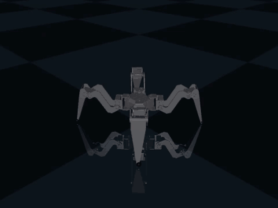

# CLAWER-4: teaching a 12-servo quadruped to walk with reinforcement learning

<p align="center"></p>

CLAWER-4 is a small quadruped robot with 12 Waveshare ST3020 bus servos (3 per leg). This project takes it
from a CAD file to a walking policy trained with **PPO** in **MuJoCo MJX**, simulating 2,048 robots at once on a single free Colab GPU.

> **Status:** walks in **simulation**. Next: domain randomisation, then running on the real robot (ESP32 + IMU).

[](https://colab.research.google.com/github/Dhanip200/clawer4-rl/blob/main/colab/train_colab.ipynb)

## Results (simulation)

| Gait | Commanded | Achieved | Notes |
|---|---|---|---|
| Hand-made sine trot (baseline) | n/a | 0.17 m/s | Wobbles (up to 13° tilt), drifts sideways |
| **PPO policy** (50M steps, 54 min on a T4) | 0.20 m/s forward | **0.201 m/s** (2.01 m in 10 s) | Stays level, only 1 cm sideways drift |

Training score per episode: 4.9 → 40 by 11M steps, then levelled off at about 45.

## Pipeline

```
STEP CAD ──► MJCF model ──► standing test ──► hand-made trot ──► RL environment ──► PPO on GPU ──► walking policy
tools/step_to_mjcf.py   tools/check_model.py  tools/sine_gait.py  rl/clawer4_env.py  rl/train.py
```

1. **CAD → MJCF** (`tools/step_to_mjcf.py`): reads the STEP assembly with OpenCASCADE, groups the parts into torso / hip / thigh / shin
   bodies, exports meshes, estimates masses (PLA at 50% infill + 97 g per servo + 0.3 kg battery/board) and writes `model/clawer4.xml`.
   Collision uses simple capsules, spheres and a box, so it runs fast on the GPU.
2. **Standing test** (`tools/check_model.py`): the robot settles at a body height of about 0.10 m.
3. **Baseline gait** (`tools/sine_gait.py`): a diagonal-pair sine-wave trot, to prove the robot *can* walk with these servos.
4. **RL environment** (`rl/clawer4_env.py`): a Brax-compatible MJX environment (details below).
5. **Training** (`rl/train.py`): Brax PPO, a live score graph, and a video of the result.

## The environment

The policy runs at **50 Hz** (10 physics steps of 2 ms each).

**Observations (45):** gravity direction in the body frame (3), body angular velocity (3), joint angles (12), joint velocities (12),
previous action (12), command (3). Body linear velocity is left out on purpose, because the real robot can't measure it. Gravity and spin come from an IMU.

**Actions (12):** values in [-1, 1] → servo target = stance pose + 0.3 rad × action.

**Commands:** forward −0.1 to 0.3 m/s, sideways ±0.1 m/s, turn ±0.6 rad/s. A new command is picked every 10 s and after every fall. 10% of commands are "stand still".

**Reward terms:**

| Term | Weight | Purpose |
|---|---|---|
| track_lin_vel | +1.5 | Match the commanded forward/sideways speed |
| track_ang_vel | +0.8 | Match the commanded turn rate |
| feet_air_time | +1.0 | Take real steps instead of shuffling |
| lin_vel_z | −2.0 | No bouncing |
| ang_vel_xy | −0.05 | No rolling or pitching |
| orientation | −5.0 | Keep the body level |
| torque | −0.001 | Save servo effort |
| action_rate | −0.01 | Smooth actions |
| joint_speed | −1.0 | Stay under the ST3020's 4.7 rad/s command limit |
| termination | −1.0 | Don't fall |

## Training setup

- **Algorithm:** PPO (Brax 0.14.2, JAX 0.11.1, MuJoCo MJX 3.17.0)
- **Networks:** policy MLP 45 → 4×128 → 12 (about 57k parameters); value MLP 5×256
- **Scale:** 2,048 parallel environments, 50M steps (about 11.5 days of robot time), 1,000-step (20 s) episodes
- **Hardware:** Google Colab, NVIDIA T4. The PPO settings are adapted from MuJoCo Playground's Go1 setup.

## Problems solved along the way

- **Training was going to take days → 16× faster.** The first run needed about 19 min per 0.3M steps. The model file used
  100 solver iterations + 50 line-search iterations, and checked every leg part against every other part for collisions.
  On a GPU, all 2,048 robots wait for the slowest one. Using 2 solver / 6 line-search iterations and **robot-vs-floor contacts only**
  made it about 16× faster with the same standing behaviour. The full run then took 54 min.
- **JAX 0.11 vs Brax 0.14:** Brax still calls `jax.device_put_replicated`, which JAX 0.11 removed. `train.py` adds a small
  replacement instead of downgrading JAX.
- **Pytree mismatch crash:** Brax's wrappers add a `reward` entry to `state.metrics`. Rebuilding the metrics dict in `step()`
  dropped it and crashed `lax.scan`. The fix is to copy and update the existing metrics instead.

## Run it yourself

**Train on Colab (free GPU):** open the notebook with the badge above, set the runtime to T4 GPU and run the cells.
The trained brain (`clawer4_policy.params`) and the video download automatically when training finishes.

**Local (CPU, no training):**
```bash
python -m venv .venv
.venv/Scripts/pip install mujoco mujoco-mjx trimesh cadquery-ocp
.venv/Scripts/python -m mujoco.viewer --mjcf=model/clawer4.xml   # look at the robot
.venv/Scripts/python tools/sine_gait.py --view                   # hand-made trot
.venv/Scripts/python tools/test_env.py                           # check the RL environment
.venv/Scripts/python tools/step_to_mjcf.py                       # rebuild the model from the CAD
```

## Repository layout

| Path | Contents |
|---|---|
| `cad/` | Original STEP assembly of the robot |
| `model/` | `clawer4.xml` (MJCF), meshes, standing/collision renders, trot GIF |
| `tools/` | CAD converter, standing test, sine trot, environment test |
| `rl/` | RL environment and PPO training |
| `colab/` | Colab notebooks (setup check, training) |
| `firmware/` | ESP32 code for the real robot (Waveshare General Driver for Robots): `hw_check` reads all servos + the QMI8658 IMU without moving anything |
| `media/` | Walking video and GIF |

## Known limitations

- Simulation only so far. Mass, servo stiffness (kp = 12) and joint limits are estimates that still need measuring on the real robot.
- Only forward walking at 0.2 m/s has been tested on video so far. Turning and sideways commands haven't been tested yet.
- The faster solver settings and lack of self-collision make the sim slightly simpler than reality. Domain randomisation is the next step to cover that gap.

## Roadmap

- [x] CAD → MJCF, standing test, hand-made trot
- [x] PPO walking policy in simulation
- [ ] Test turning / sideways / standing commands
- [ ] Domain randomisation (mass, friction, servo strength, pushes)
- [ ] Deploy on the real robot (ESP32 servo driver + IMU)
